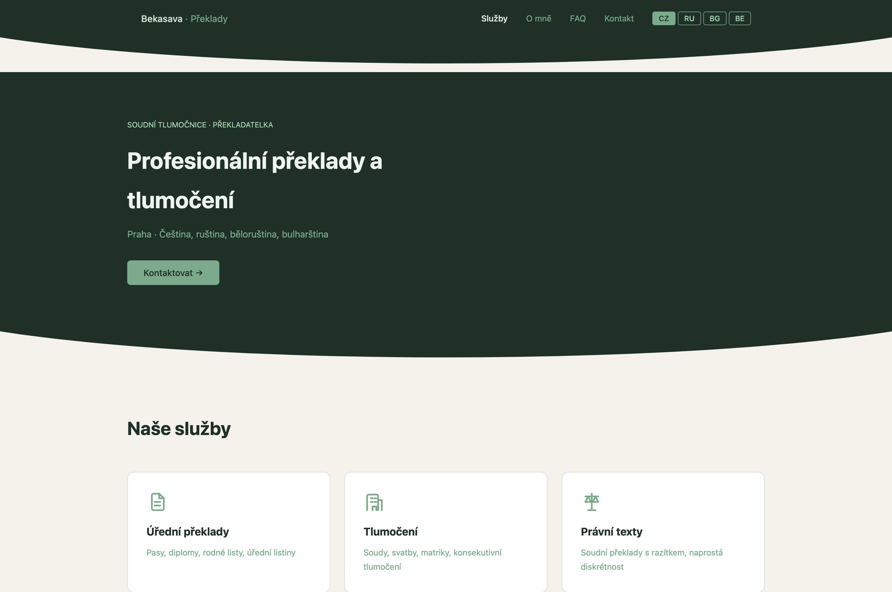
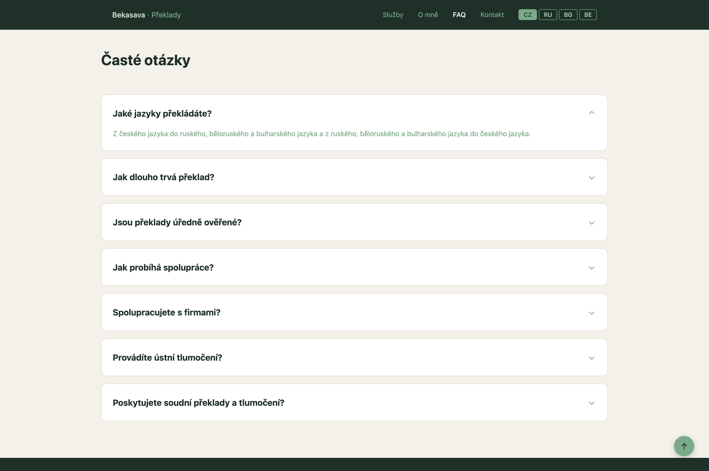
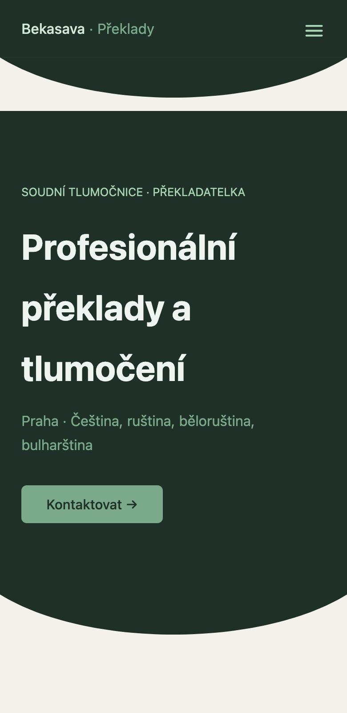
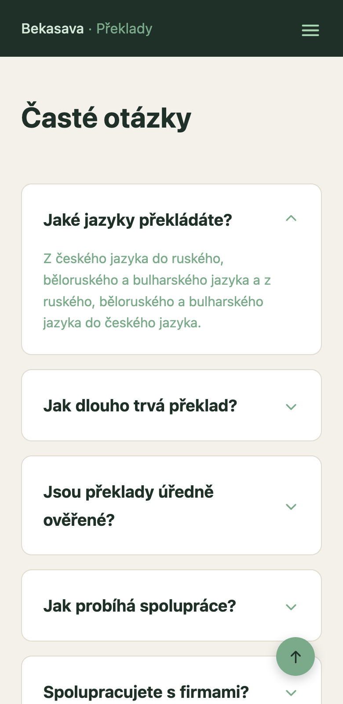

# Court Interpreter Website

A four-language website for people looking for certified translation and court interpreting services in Prague.

**Status:** Built for Mgr. Aksana Bekasava Ph.D. and deployed at bekasava.eu. The live site is currently offline.

## Screenshots

Taken from the local Vite development server.

| Desktop hero | Desktop FAQ open | Mobile hero | Mobile FAQ open |
| --- | --- | --- | --- |
|  |  |  |  |

## Tech stack

- React 19.2.6 / TypeScript 6.0.3 / Vite 8.0.13
- Plain CSS
- Apache hosting; `.htaccess` sets the directory index and disables directory listings

## Features

- Four languages (`cz`, `ru`, `bg`, `be`), switched with buttons in the navigation. The selected language lives in React state and resets to Czech after a reload.
- Keyboard-accessible FAQ with `aria-expanded` and visible focus outlines.
- Scroll-triggered fade-ins built on `useInView` and `IntersectionObserver`. Transitions and animations are disabled when `prefers-reduced-motion: reduce` is set.
- Contact section with a Google Map, contact details, and `mailto:` and `tel:` links. Despite its name, the `ContactForm` component does not submit any data.

## Project structure

```text
src/
  components/   About, ContactForm, Divider, FAQ, Footer, Hero, Icons,
                Navbar, ScrollToTop, Services
  hooks/
    useInView.ts  Adds the visible class when an element enters view
    useCount.ts   Animates the years-of-experience counter
  translations.ts  Typed Czech, Russian, Bulgarian, and Belarusian copy;
                    one file keeps locale fields together for comparison
update_translations.py  Legacy helper that inserts sample pricing fields
                       into translations.ts in place using regular expressions
.htaccess  Sets index.html as Apache's directory index and disables
           directory listings
```

## Code highlights

### 1. Typed translations without a library

```ts
type TranslationMap = Record<"cz" | "ru" | "bg" | "be", TranslationItem>;
```

All four locale objects are required, and each must have the same `TranslationItem` fields. If `ru` is missing from `t`, TypeScript reports an error at build time instead of the locale disappearing at runtime. The same applies to individual fields: leaving `faqTitle` out of the Russian entry is a type error.

### 2. `useInView`

```ts
export function useInView() {
  const ref = useRef<HTMLElement>(null);
  useEffect(() => {
    const observer = new IntersectionObserver(
      ([entry]) => {
        if (entry.isIntersecting) entry.target.classList.add("visible");
      },
      { threshold: 0.1 },
    );
    if (ref.current) observer.observe(ref.current);
    return () => observer.disconnect();
  }, []);
  return ref;
}
```

`IntersectionObserver` adds the `visible` class when the section enters the viewport. The cleanup function disconnects the observer when the component unmounts.

### 3. Accessible FAQ

Each FAQ item uses `role="button"`, `tabIndex={0}`, and `aria-expanded={openIndex === i}`. The key handler toggles the item on Enter or Space, and `src/index.css` styles `:focus-visible` with an outline. Checked manually with keyboard only (Tab, Enter, Space); screen readers not tested.

## What was hard

Keeping four locales structurally aligned when the copy differs in length and the FAQ includes a long legal answer. The shared `TranslationItem` type catches missing fields at build time, and the FAQ keeps answers collapsed until a visitor opens one.

## What I learned

- `Record` makes a small set of static translations type-safe. Next time I would define the language union once and reuse it in both the app and the translation map.
- `IntersectionObserver` ties scroll effects to visible sections, and reduced-motion CSS lets visitors who ask for less movement get it.

## Run locally

```bash
npm install
npm run dev
```

## Credits

Built by Petr Komar for Mgr. Aksana Bekasava Ph.D., a court interpreter and translator in Prague.
